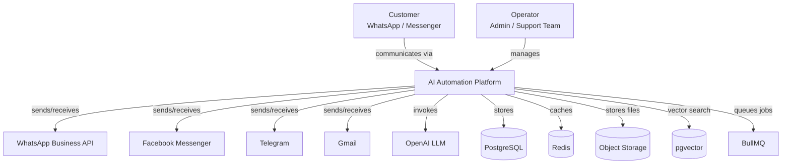
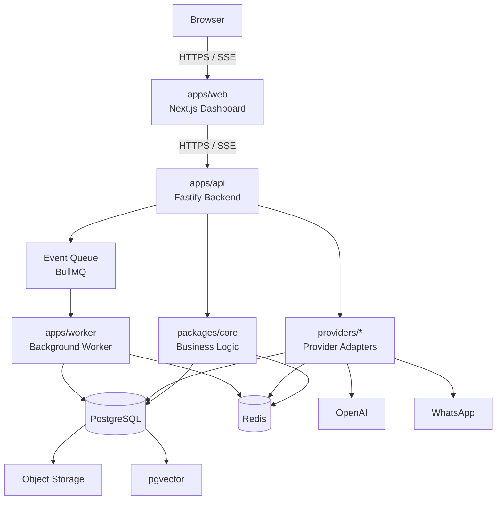
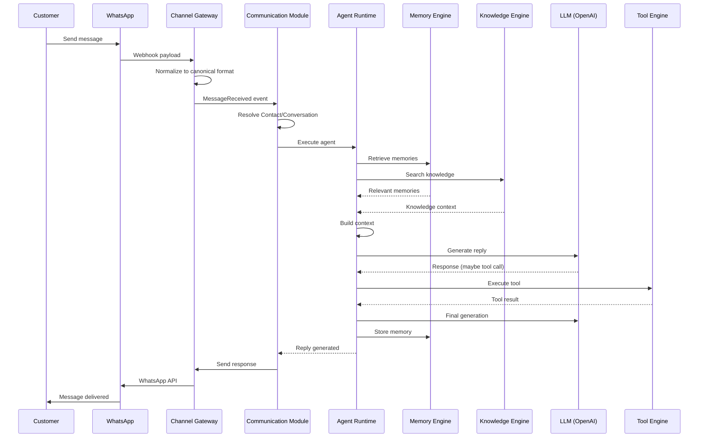
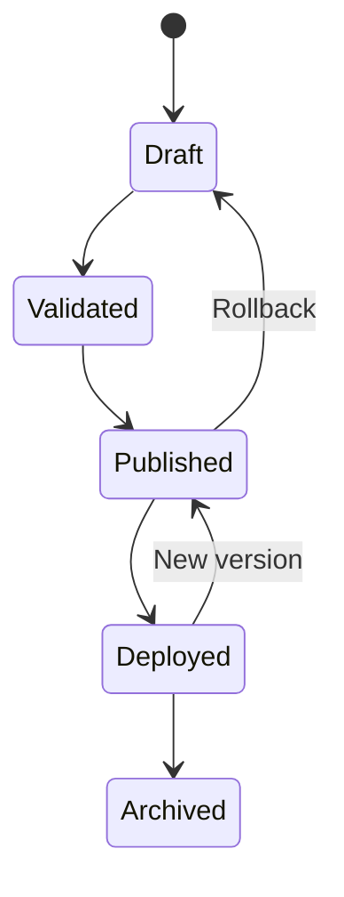
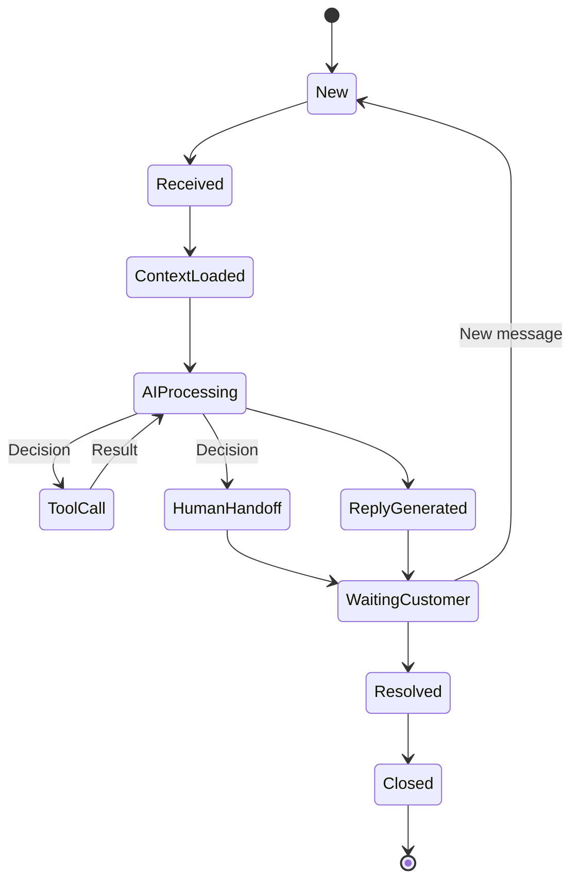
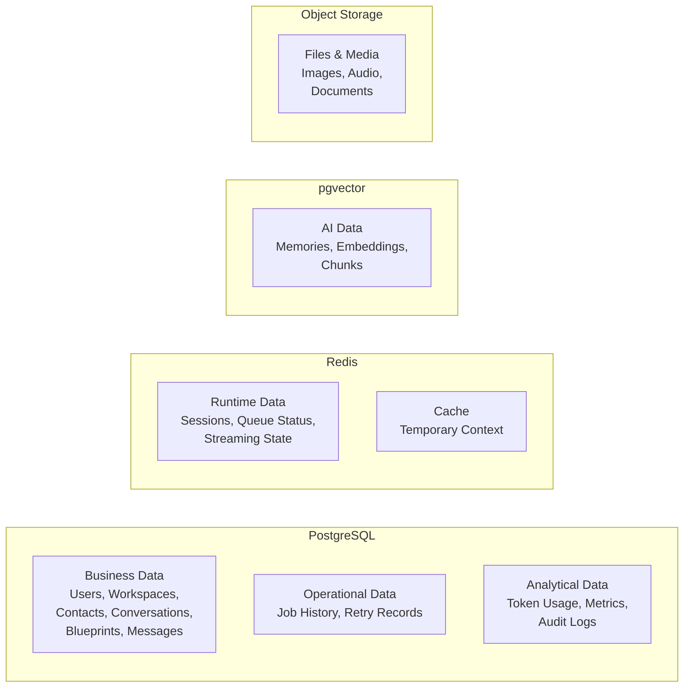
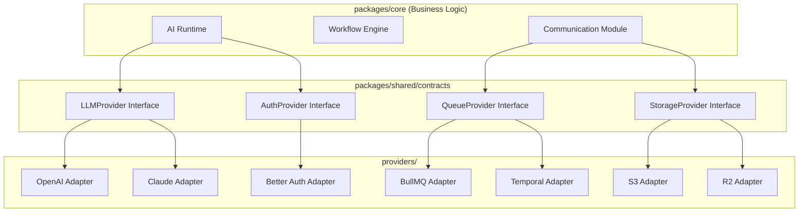

# ExpoAgentService — Customer Service AI Automation Platform

---
Planing & DOC Author: AK Shoikat
Explanation: Dromput Brain 
Codebase Author : Rahad Bhuiya ( Karnel Hacker )
Date: July 6, 2026  
Version: 1.0.0  

---

## 1. Executive Summary
Expo-Agent is a **blueprint-driven, multi-tenant AI automation platform** designed to unify customer communication, AI agent execution, workflow automation, knowledge management, memory, and business operations into a single extensible system. It is not a chatbot or a simple workflow tool — it is an **AI Operating System** where businesses deploy role-specific AI agents (Social Media Manager, Hotel Receptionist, Medical Receptionist, CRM Assistant, etc.) through declarative **Blueprints** executed by a shared runtime Under Exploidus.com.

---

## 2. Product Vision

> *"Build one AI platform capable of powering every business communication and automation workflow through intelligent agents."*
>
> — Constitution

The platform enables organizations to:
- Connect multiple communication channels (WhatsApp, Facebook Messenger, Instagram, Telegram, Gmail, Live Chat)
- Deploy role-specific AI agents without writing code
- Automate complex business workflows
- Manage long-term AI memory and business knowledge
- Monitor all interactions from one unified environment

**Core Philosophy:**
- Everything is an Agent
- Everything is a Workflow
- Everything produces Events
- Everything is Observable
- Everything is Extensible

---

## 3. Client Problem

Businesses operating across multiple customer communication channels face a fragmented technology landscape:

| Pain Point | Description |
|---|---|
| Channel Fragmentation | WhatsApp, Facebook, Instagram, Telegram, Gmail — each requires separate tools |
| AI Fragmentation | Each AI use case (support, booking, social media) requires separate bot implementations |
| No Unified Memory | AI agents have no persistent memory across conversations |
| Hard to Scale | Adding new channels or AI capabilities requires rebuilding |
| No Reusable AI | Same AI infrastructure cannot serve hotel, healthcare, CRM, and support simultaneously |

**Existing solutions failed because:**
- Chatbot builders are too rigid (domain-specific, not extensible)
- Workflow tools (n8n, Zapier) lack AI-native capabilities
- Custom development is expensive and not reusable
- Vertical SaaS products (e.g., hotel PMS, CRM) solve one problem but don't compose

---

## 4. Solution Overview
 Expo-Agent solves this by introducing a **Blueprint-Driven Architecture** with three fundamental separations:

```
┌─────────────────────────────────────────────────────┐
│                  DESIGN LAYER                        │
│  Blueprints • Personas • Policies • Knowledge • Workflows │
├─────────────────────────────────────────────────────┤
│                  RUNTIME LAYER                       │
│  Conversation Engine • Memory Engine • Tool Engine   │
│  Knowledge Engine • Channel Engine • Blueprint Engine│
├─────────────────────────────────────────────────────┤
│              INFRASTRUCTURE / PROVIDER LAYER         │
│  PostgreSQL • Redis • OpenAI • WhatsApp • BullMQ   │
└─────────────────────────────────────────────────────┘
```

**Key innovation:** A single generic Agent Runtime executes any AI role. Business-specific behavior is defined entirely through Blueprints (declarative configuration), not code.

---

## 5. User Journey

### Flow 1: Customer → AI Conversation

```
Customer
    │
    ▼  (sends WhatsApp message)
WhatsApp Business API
    │
    ▼
Integration Hub → Channel Gateway
    │  (normalizes payload → canonical message)
    ▼
Communication Module
    │  (resolves Contact, finds/creates Conversation)
    ▼
Agent Runtime (Blueprint Engine)
    │  (loads Blueprint → Persona, Knowledge, Memory config)
    ▼
Conversation Engine
    ├── Memory Engine (retrieve relevant memories)
    ├── Knowledge Engine (search knowledge base)
    └── LLM (OpenAI) → generates reply
    │
    ▼
Need Tool? → Tool Engine (CRM/Calendar/etc.)
    │
    ▼
Store Memory → Send Reply → Channel Engine → WhatsApp → Customer
```

### Flow 2: Human Handoff

```
AI Agent
    │
    ▼
Need Human? → Yes → Queue for Operator
    │
    ▼
Operator Inbox → Human Response → Customer
    │
    ▼
AI Resume (conversation continues)
```

### Flow 3: Blueprint Lifecycle (Business Owner)

```
Create Blueprint → Define Persona → Bind Knowledge → Assign Tools
    → Set Safety Policies → Configure Model → Publish
    → Deploy → Agent Instance Running → Monitor Analytics
```

---

## 6. Feature Breakdown

### V1 Features (First Product — "Social Media AI Automation")

| Feature | Description |
|---|---|
| Workspace Management | Multi-tenant organization boundaries |
| User Authentication | Login, roles, sessions (Better Auth) |
| WhatsApp Cloud API | Primary communication channel |
| Unified Inbox | All conversations in one view |
| Manual Reply | Human operators respond |
| Contact Management | Customer profiles across channels |
| Conversation History | Full message timeline |
| AI Reply Suggestion | AI generates response suggestions |
| AI Auto Reply | Configurable automated responses |
| Basic Knowledge Base | FAQ, documents, PDFs |
| Basic Memory | Short-term conversation memory |
| Agent Configuration | Persona, instructions, model settings |
| Audit Log | Immutable security history |

### V2 Features (Planned)
- Facebook Messenger & Instagram integration
- Workflow Builder (visual)
- Multi-channel expansion (Telegram, Gmail, Live Chat)
- Advanced memory system
- Human handoff workflow
- Analytics dashboard

### V3 Features (Planned)
- Blueprint Marketplace
- Multi-agent collaboration
- Voice & vision agents
- Mobile app
- Plugin system

### Core Feature: Blueprint System

The platform's defining feature. A Blueprint is a declarative configuration containing:
- **Persona** — Tone, style, personality, restrictions
- **Instructions** — System prompts for the AI
- **Knowledge Bindings** — Which knowledge bases to use
- **Tool Bindings** — Which tools the agent can call
- **Workflow Bindings** — Automation rules
- **Safety Policies** — Content moderation, escalation rules
- **Memory Profile** — How memory is stored/retrieved
- **Model Profile** — LLM configuration (provider, temperature, etc.)
- **Channel Permissions** — Which channels the agent serves

---

### Architecture Pattern

**Modular Monolith + Vertical Slices + Clean Architecture + Domain-Driven Design**

---

## 8. Architecture Overview

### C4 Model — Level 2: Container Architecture

```
                    ┌──────────────────────────────┐
                    │         Browser               │
                    └──────────────┬───────────────┘
                                   │
                                   ▼
                          apps/web (Next.js)
                                   │
                      HTTPS / SSE (V1) / WebSocket (Future)
                                   │
                                   ▼
                         apps/api (Fastify)
                                   │
         ┌───────────────┬──────────┴───────────────┐
         ▼               ▼                          ▼
 packages/core     providers/*                Event Queue
         │               │                     (BullMQ)
         │               │                          │
         │               │                          ▼
         └───────────────┼───────────────┬──────────┘
                         ▼               ▼
                  PostgreSQL          Redis
                         │              │
                         ▼              ▼
                   Object Storage   Vector Store
                   (S3/R2/MinIO)   (pgvector V1)
                         │
                         ▼
               External Providers
    (OpenAI, WhatsApp, Meta, Telegram, Gmail ...)
```

### Core Architectural Decisions

| Decision | Choice | Reason |
|---|---|---|
| Repository | Modular Monorepo (Turborepo + pnpm) | Type sharing, single pipeline, future extraction |
| DI Strategy | No DI Container — Composition Root | Less magic, easier debugging, small team |
| AI Framework | Framework-agnostic — Adapter Layer | Business logic never knows about LangGraph/CrewAI |
| Execution | Engine Pattern — stateless, replaceable | Each engine independently testable |
| Communication | Event-Driven (BullMQ) | Async processing, retry, decoupling |
| Database | Hybrid persistence (PG + Redis + Object + Vector) | Right tool for each data type |

---

## 9. Data Flow

### Primary Execution Path

```
1. INGRESS
   WhatsApp Webhook → Provider Adapter → Channel Gateway
       ↓ Normalizes to canonical IncomingMessage
       ↓ Verifies signature, deduplicates, resolves Contact/Conversation

2. COMMUNICATION
   Channel Gateway → Communication Module
       ↓ Creates/updates Conversation
       ↓ Updates Contact
       ↓ Publishes MessageReceived event

3. ORCHESTRATION
   Agent Runtime picks up event
       ↓ Blueprint Engine loads Blueprint configuration
       ↓ Memory Engine retrieves relevant context
       ↓ Knowledge Engine searches vector store
       ↓ Context Assembler builds prompt

4. EXECUTION
   LLM (OpenAI) → generates response
       ↓ May trigger Tool Calls (CRM, Calendar, etc.)
       ↓ Tool Engine executes, returns result
       ↓ LLM generates final reply

5. EGRESS
   Reply → Conversation Engine → Channel Engine → WhatsApp → Customer
       ↓ Memory Engine stores important information
       ↓ Analytics event published
```

### Failure Recovery

| Failure | Strategy |
|---|---|
| AI Provider down | Worker retry → Fallback model (future) |
| WhatsApp down | Queue retry |
| Worker crash | Resume job |
| Redis down | Degraded mode |
| Database fail | Read-only protection (future) |

---

## 10. Database Design

### Storage Strategy

| Data Type | Storage | Characteristics |
|---|---|---|
| Business Data (Users, Workspaces, Contacts, Conversations, Blueprints) | PostgreSQL | ACID, highest consistency |
| Runtime Data (Sessions, Queue Status, Streaming State) | Redis | Disposable, fast |
| AI Data (Memories, Embeddings, Chunks) | pgvector (V1) | Regenerable |
| Files/Media (Images, Audio, Documents) | S3/MinIO/R2 | Large objects |
| Operational Data (Job History, Retry Records) | PostgreSQL | Append-heavy |
| Analytical Data (Token Usage, Metrics) | PostgreSQL | Append-heavy |

### Ownership Rules

- Every table has **exactly one owner module**
- Every tenant-owned entity must contain `workspace_id`
- Only global entities (countries, languages, system settings) exist without workspace ownership
- Soft delete: enabled for business-recoverable entities (Contacts, Conversations, Blueprints), disabled for cache, embeddings, sessions
- Versioning: only for immutable business artifacts (Blueprints, Workflows, Policies)

### Workspace Isolation

```
Everything belongs to exactly one Workspace unless explicitly
defined as a global platform resource.
```

---

## 11. API Documentation

### Module API Contracts (Planned)

| Module | Public API Examples |
|---|---|
| Identity | Create User, Login, Logout, Validate Session, Check Permission |
| Workspace | Create Workspace, Invite Member, Remove Member, Update Settings |
| Communication | Create Conversation, Send Message, Receive Message, Assign Conversation, Archive Conversation |
| Agent Runtime | Execute Agent, Generate Reply, Run Tool, Build Context |
| Knowledge | Upload Document, Delete Document, Search Knowledge |
| Memory | Store Memory, Retrieve Memory, Summarize Conversation |
| Workflow | Start Workflow, Stop Workflow, Execute Node |
| Integration Hub | Connect Provider, Disconnect Provider, Verify Connection |

**Tech Stack for API:** Fastify + Zod validation + Prisma ORM

---

## 12. Component Documentation

### Execution Engines

#### Conversation Engine
- **Input:** Incoming Message
- **Output:** Conversation Context
- **Responsibility:** Conversation lifecycle, state transitions, context loading, message routing, human handoff, session management

#### Blueprint Engine
- **Input:** Blueprint ID
- **Output:** Resolved Runtime Configuration
- **Responsibility:** Blueprint loading, version resolution, deployment resolution, configuration merging

#### Memory Engine
- **Input:** Conversation
- **Output:** Relevant Memories
- **Responsibility:** Memory scoring, storage, semantic retrieval, summarization, context optimization

#### Knowledge Engine
- **Input:** User Query
- **Output:** Knowledge Context
- **Responsibility:** Search, retrieval, ranking, chunk selection, citation generation

#### Tool Engine
- **Input:** Tool Request
- **Output:** Tool Result
- **Responsibility:** Tool discovery, permission checking, parameter validation, execution, retry, result normalization

#### Channel Engine
- **Input:** Provider Payload
- **Output:** Canonical Message
- **Responsibility:** Provider normalization, message delivery, delivery status, retry, idempotency

#### Integration Engine
- **Input:** Provider Connection Request
- **Output:** Connection Status
- **Responsibility:** Provider lifecycle, credential management, health checks, rate limiting

---

## 13. AI / Automation Pipeline

### AI as a Core Runtime

AI is not a feature of any module — it is the platform's execution layer:

```
Platform
    │
    ▼
AI Runtime (shared)
    │
    ├── Social Media Agent (Blueprint)
    ├── Hotel Receptionist (Blueprint)
    ├── Medical Receptionist (Blueprint)
    ├── CRM Assistant (Blueprint)
    └── Customer Support Agent (Blueprint)
```

### Provider Abstraction

```
Application
    │
    ▼
LLM Interface (contract)
    │
    ├── OpenAI Adapter (V1)
    ├── Claude Adapter (Future)
    ├── Gemini Adapter (Future)
    └── Ollama Adapter (Future)
```

### Blueprint Execution Flow

```
Blueprint (declarative config)
    │
    ▼
Deployment (versioned release)
    │
    ▼
Agent Instance (runtime process)
    │
    ▼
Conversation (execution context)
    │
    ▼
Execution Cycle:
    Normalize → Load Context → Retrieve Memory → Search Knowledge
    → Build Prompt → LLM → Tool Call (if needed) → Store Memory → Respond
```

### Lifecycle-Driven Design

Every component has an explicit state machine:

- **Blueprint:** Draft → Validated → Published → Deployed → Archived
- **Agent Instance:** Created → Initializing → Ready → Running → Paused → Stopped
- **Conversation:** New → Received → Context Loaded → AI Processing → Reply Generated → Waiting Customer → Resolved → Closed
- **Tool:** Requested → Authorized → Executing → Succeeded / Failed → Retry
- **Knowledge:** Uploaded → Validated → Chunked → Embedded → Indexed → Available
- **Memory:** Conversation Event → Candidate → Scored → Stored → Embedded → Searchable
- **Worker Job:** Queued → Running → Completed / Failed → Retry → Dead Letter

---

## 14. Business Logic

### 12 Core Domains

| Domain | Responsibility | Key Entities |
|---|---|---|
| Identity | Authentication, Authorization | User, Role, Permission, Session, API Key |
| Workspace | Tenant Boundary | Organization, Workspace, Team, Members, Settings |
| Communication | Omnichannel Inbox | Channel, Contact, Conversation, Message, Inbox, Assignment, Labels |
| Agent Runtime | AI Execution | Agent, Persona, Prompt, Tool Registry, Model, AI Session |
| Knowledge | Business Information | Documents, FAQ, Web Pages, PDFs, Embeddings |
| Memory | Learned Context | User Memory, Conversation Memory, Long-term, Semantic |
| Workflow | Automation | Workflow, Trigger, Action, Condition, Execution, Scheduler |
| Integration Hub | External Connectivity | Integration, Credential, Webhook, Provider |
| Notification | Alerts | Email, Push, SMS, Internal Notification |
| Analytics | Reporting | Usage, Reports, Metrics, Token Usage, Performance |
| Billing | Subscriptions | Subscription, Invoice, Usage, Payment |
| Administration | System Config | Audit Logs, Feature Flags, Platform Settings |

### Domain Dependency Graph

```
                 shared
                    │
        ┌──────────┴──────────┐
        ▼                      ▼
    identity              workspace
        │                      │
        └──────────┬──────────┘
                   ▼
            communication
                   │
        ┌──────────┼────────────┐
        ▼          ▼            ▼
      agent    workflow    notification
        │          │
        ├─────┬────┘
        ▼     ▼
    knowledge memory
                   │
                   ▼
              analytics
```

### Business Rules

- **Workspace owns everything** — All entities belong to exactly one workspace
- **Blueprint defines behavior** — Agents are configured, not coded
- **Engines execute** — Stateless runtime, no business logic
- **Providers integrate** — Third-party adapters, never in core
- **One owner per entity** — Only one module writes a given table
- **Forbidden dependencies:** Knowledge → Identity, Memory → Workspace, Workflow → PostgreSQL, Agent → WhatsApp SDK

---

## 15. Security

| Principle | Implementation |
|---|---|
| Secrets in code | Never — environment variables only |
| Least privilege | Role-based access control per workspace |
| Sensitive data | Encrypted at rest |
| Authentication required | All protected resources |
| Audit trail | Immutable logs for critical operations |
| Soft delete | Business-recoverable entities only |
| Channel verification | Signature verification on webhooks |

---

## 16. Performance

| Area | Strategy |
|---|---|
| API Server | Fastify (high-performance Node.js framework) |
| Caching | Redis (sessions, rate limits, temporary context) |
| Vector Search | pgvector (co-located with PostgreSQL, no extra network hop) |
| Background Processing | BullMQ (async, queue-based) |
| Real-time | SSE (V1) → WebSocket (future) |
| Frontend | Next.js SSR + TanStack Query caching |
| Storage | S3-compatible object storage |

---

## 17. Deployment

### V1 Deployment

- **Three containers:** Web, API, Worker (can run on same server)
- **Docker Compose** for both dev and production
- **Infrastructure:** PostgreSQL, Redis, Object Storage (MinIO dev / R2 or S3 prod)

### Future Scaling

```
V1: apps/web + apps/api + apps/worker (single process each)
    → Vertical scaling

V2: Split worker into:
    apps/worker-ai
    apps/worker-media
    apps/worker-workflow
    → Horizontal scaling by workload type
```

---

## 18. Technology Stack

| Layer | Technology | Rationale |
|---|---|---|
| Frontend | Next.js + React + TypeScript | SSR, App Router, strong ecosystem |
| Styling | Tailwind CSS | Fast, small bundle |
| Icons | Lucide | Consistent icon set |
| State | Zustand | Simple, minimal boilerplate |
| Server State | TanStack Query | Caching, optimistic updates, retry |
| Backend | Fastify + TypeScript | High performance, plugin architecture |
| ORM | Prisma | Type-safe, migrations |
| Validation | Zod | Schema → validation + type inference |
| Database | PostgreSQL | ACID, mature, JSONB |
| Vector | pgvector (V1) → Qdrant (Future) | Co-located with PG initially |
| Cache | Redis | Sessions, rate limits, queue |
| Queue | BullMQ | Retry, delay, scheduling |
| AI | OpenAI (V1) + Provider Interface | Extensible to Claude, Gemini, Ollama |
| Auth | Better Auth | Modern, self-hostable, TypeScript |
| Storage | S3 / MinIO / R2 | Object storage |
| Real-time | SSE (V1) → WebSocket (Future) | Streaming AI responses |
| Logging | Pino | Fast, structured JSON |
| Test | Vitest + Playwright | Modern testing |
| Monorepo | Turborepo + pnpm | Build caching, disk efficient |
| Deployment | Docker Compose | Consistent dev/prod environments |

---

## 19. Development Workflow

### Documentation-First Development

```
Idea
  ↓
Documentation
  ↓
Architecture
  ↓
Database Design
  ↓
API Design
  ↓
Implementation
  ↓
Testing
  ↓
Git Commit
```

### Commit Philosophy

> "This project will succeed not by how fast we write code, but by how little we need to refactor."

**Quality Gates:**
- Constitution compliance
- Module boundary integrity
- No new unnecessary dependencies
- Provider abstraction maintained
- Shared package policy followed
- V1 scope respected
- Future extension points present
- Documentation updated

### Versioning

Semantic Versioning: `Major.Minor.Patch`

Breaking changes → Major version bump.

---

## 20. Engineering Decisions

### Architecture Decision Records

| ADR | Decision |
|---|---|
| 0001 | Universal AI Automation Platform (not social media tool) |
| 0002 | AI as a Core Runtime (not a module feature) |
| 0003 | Simplicity First — build only what V1 needs |
| 0004 | Controlled Vocabulary — one term per concept |
| 0005 | Framework-agnostic AI Runtime (adapter pattern) |
| 0006 | Modular Monorepo |
| 0007 | Logical Modularity First, Physical Modularity Later |
| 0008 | No DI Container — Composition Root |
| 0009 | Module Ownership — one owner per entity |
| 0010 | Shared Kernel Policy — business-neutral shared package |
| 0011 | Unified Channel Gateway — provider normalization |
| 0012 | Blueprint-Based Agent Architecture |
| 0013 | Blueprint Lifecycle & Deployment (design vs runtime) |
| 0014 | Three-container separation (Web, API, Worker) |
| 0015 | Workspace-Centric Domain Model |
| 0016 | Lifecycle-Driven Runtime — explicit state machines |
| 0017 | Execution Engine Pattern |
| 0018 | Ownership-First Database Architecture |
| 0019 | Platform as a Conceptual Root |

### Why Fastify over Express?
Higher performance, plugin architecture, better TypeScript support, Pino integration.

### Why pgvector over Qdrant (V1)?
Co-located with PostgreSQL, lower operational complexity, sufficient for V1 scale, upgrade path to Qdrant exists.

### Why BullMQ over Temporal (V1)?
Lower operational complexity, retry/delay/scheduling sufficient for V1, upgrade path to Temporal exists.

### Why Zustand over Redux?
Simple, minimal boilerplate, sufficient for V1 complexity.

---

## 21. Risks

| Risk | Impact | Mitigation |
|---|---|---|
| No code written yet | High — project is ~25% through planning | Planning is thorough; implementation will be mechanical |
| Complexity of Blueprint system | Medium — declarative configs can grow unwieldy | Strict schema, versioned Blueprints, UI-driven editor |
| Multi-tenant isolation | Medium — workspace_id everywhere | Database-level isolation enforced by schema |
| AI provider dependency | Medium — OpenAI single point of failure | Provider abstraction allows future fallback models |
| Eventual consistency challenges | Low — async processing via BullMQ | Well-defined event contracts, idempotency |
| Language barrier | Low — documentation is bilingual (Bengali + English) | Core code and APIs in English |

---

## 22. Future Roadmap

### V1 — Social Media AI Automation
Workspace, User auth, WhatsApp integration, unified inbox, manual/AI reply, basic knowledge base, basic memory, agent configuration, audit log.

### V2 — Multi-Channel + Workflow
Facebook Messenger, Instagram, Telegram, workflow builder (visual), advanced memory (long-term, semantic), human handoff, analytics dashboard.

### V3 — Marketplace + Multi-Agent
Blueprint Marketplace, multi-agent orchestration, voice & vision agents, mobile app, plugin system.

### Long-Term Products
Hotel Reception AI, Medical Reception AI, CRM AI Assistant, HR Assistant, Sales Assistant, E-commerce Assistant, Internal Company Assistant.

---

## 23. Mermaid Diagrams

### System Context (C4 Level 1)



### Container Architecture (C4 Level 2)



### Runtime Execution Cycle



### Blueprint Lifecycle



### Conversation State Machine



### Data Classification & Storage Matrix



### Provider Abstraction Pattern



---

## 24. Appendix

### Terminology (Ubiquitous Language)

| Term | Definition | Forbidden Alternatives |
|---|---|---|
| Workspace | A business entity / tenant | Company, Organization, Tenant |
| User | A human using the platform | — |
| Contact | A person communicating with a workspace | Customer, Client, Guest, Patient |
| Channel | Communication medium | Platform, Integration |
| Conversation | A continuous interaction between Contact and Workspace | Chat, Thread, Session |
| Message | Single atomic communication unit | — |
| Agent | AI worker | Bot, Chatbot, Assistant |
| Blueprint | Declarative agent configuration | Template, Config |
| Persona | Agent's personality/tone | — |
| Memory | Agent's learned context | History, Log |
| Knowledge | Static business information | Docs, Database |
| Tool | Capability an agent can invoke | Action, Function |
| Workflow | Automation process | Pipeline, Flow |
| Integration | External system connector | Connection |
| Provider | Implementation of an integration | Driver, SDK |

### Evidence File Index

All source documentation resides in `adaptive intelligence system Expo-Agent/Story/`:

| Path | Content |
|---|---|
| `00-platform.md` | Platform root specification, aggregate structure |
| `Doc/constitution/00-project-principles.md` | 20 engineering principles |
| `Doc/constitution/01-project-goals.md` | Mission, 8 business goals, success criteria |
| `Doc/constitution/02-project-scope.md` | Platform scope, V1 scope, architecture layers |
| `Doc/constitution/03-platform-architecture-principles.md` | 5 architecture tenets + 12 core domains |
| `Doc/constitution/04-core-domain-model.md` | Domain responsibilities, relationships |
| `Doc/constitution/05-ubiquitous-language.md` | Controlled vocabulary, forbidden terms |
| `Doc/design/01-technology-stack.md` | Full tech stack with rationale |
| `Doc/design/02-monorepo-structure.md` | Repository layout, package purposes |
| `Doc/design/03-module-boundaries.md` | 12 module responsibilities, APIs, events, ownership |
| `Doc/design/04-system-context.md` | C4 Level 1, external actors, system boundary |
| `Doc/design/05-container-architecture.md` | C4 Level 2, deployment containers, communication |
| `Doc/design/06-domain-model.md` | 8 aggregates, ownership rules, lifecycle example |
| `Doc/design/07-runtime-lifecycle.md` | 9 lifecycles, execution cycle, failure recovery |
| `Doc/design/08-execution-engine-architecture.md` | 7 engines, engine catalog, interaction flow |
| `Doc/design/09-database-architecture.md` | Hybrid storage strategy, data classification, ownership |
| `ADR/0001`–`ADR-0017` | 17 Architecture Decision Records |
| `Note-0001`–`0005` | Planning notes, refinements |
| `PDS/PDS Rule-001.md` | Technology replaceability rule |
| `domain/aggregates/workspace.md` | Aggregate datasheet (stub) |

<!-- ### Missing Information

The following would be needed for a complete implementation picture:
1. **Database schema** (Prisma models or SQL DDL)
2. **API route definitions** (Fastify route files)
3. **UI component tree** (React component files)
4. **Test files** (Vitest / Playwright specs)
5. **Docker Compose files** (docker-compose.yml)
6. **CI/CD configuration** (.github/workflows) -->

## Developer Information

**Project:** ExpoAgentService (Winter Ecosystem). 
**Development Status:** Planning & Documentation / Development. 
**Project Framework:** Next.js.
**Project Started:** July 14, 2026.
**First Version Released:** September 12, 2026.


### Project Documentation Notice

Some system components, modules, and technical implementations are not yet available because the project is currently in its planning and documentation phase. This section provides the developer information and project background for the Exploidus Channel.
